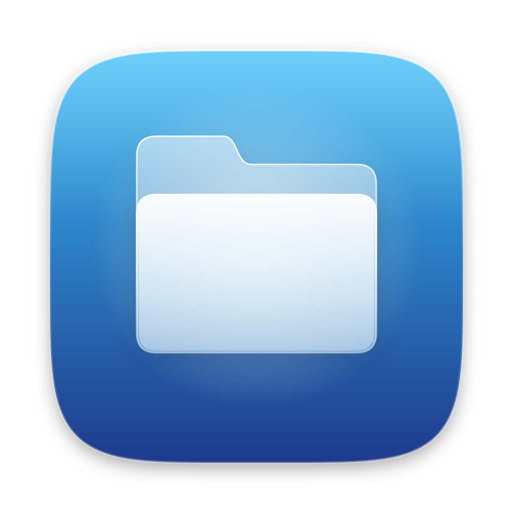
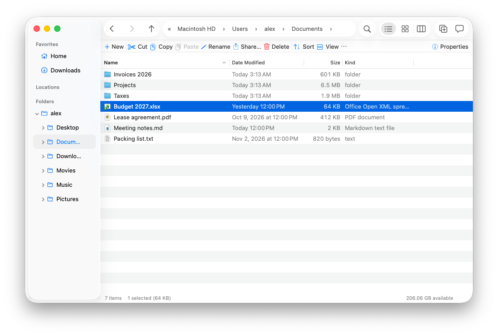
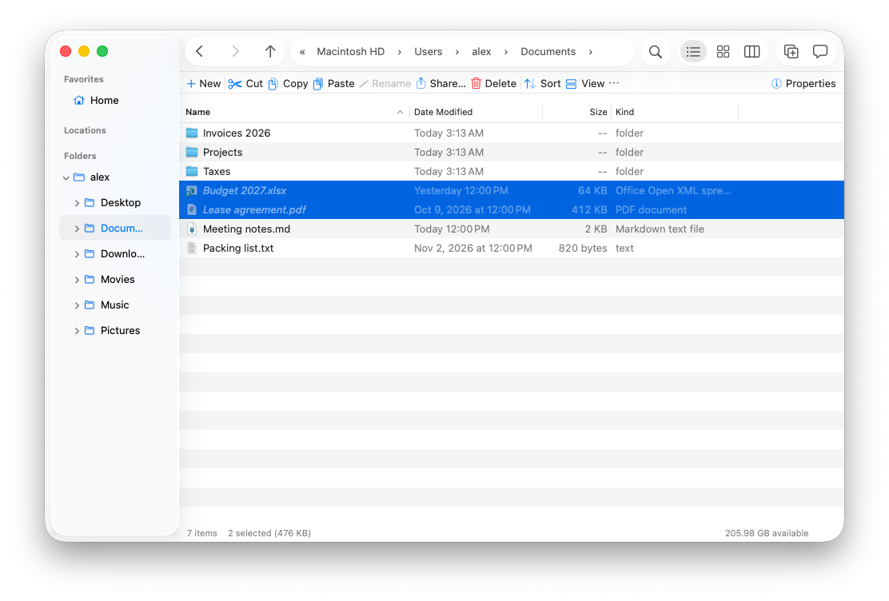
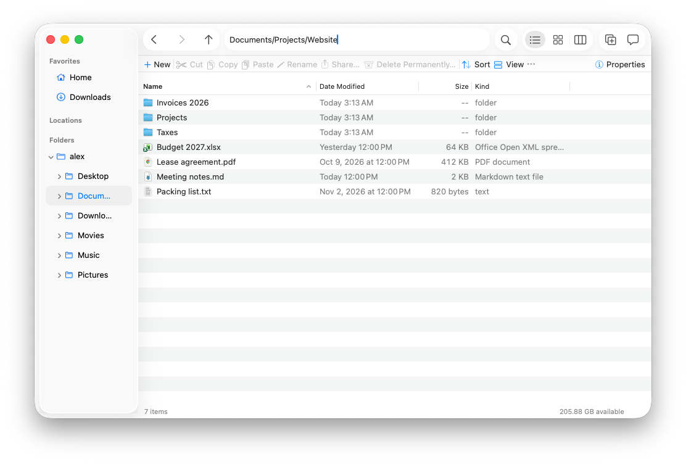
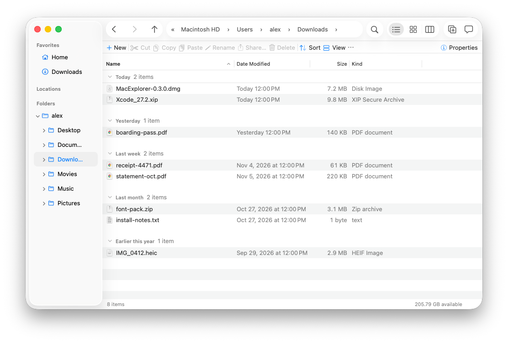
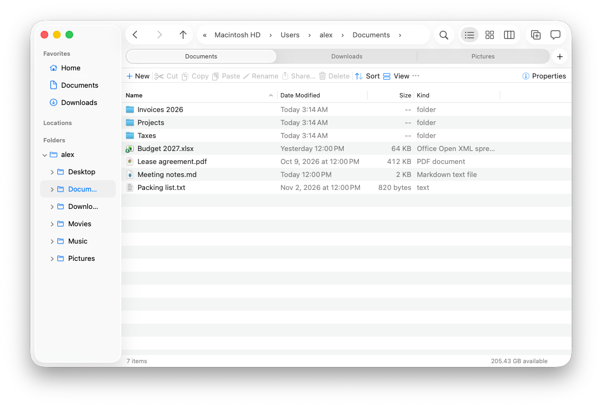

<p align="center"></p>

<h1 align="center">MacExplorer</h1>

<p align="center">Finder, with the good parts of Windows File Explorer.<br>
Cut and paste. An address bar you can type in. A folder tree. Folder sizes.</p>

<p align="center"><a href="https://roniburd.github.io/macExplorer/"><b>roniburd.github.io/macExplorer</b></a></p>

<p align="center"></p>

## Install

1. Download `MacExplorer-<version>.dmg` from [Releases](https://github.com/roniburd/macExplorer/releases/latest).
2. Open it and drag MacExplorer to Applications.

Or with [Homebrew](https://brew.sh):

```bash
brew install --cask roniburd/macexplorer/macexplorer
```

Needs macOS 26 (Tahoe). MacExplorer isn't notarized yet, so the first time macOS may refuse to open it. Run this once:

```bash
xattr -dr com.apple.quarantine /Applications/MacExplorer.app
```

It updates itself after that.

## Why?

Lots of people use Windows at work and a Mac at home, or switched after years of File Explorer. Finder does a lot
well, but a few everyday things are harder than they need to be: moving files, typing a path, seeing where you are,
finding what's big. MacExplorer keeps the Mac habits and borrows the Explorer ideas that make those jobs easier.

- **Native.** AppKit, Liquid Glass, dark mode, VoiceOver. It looks like it belongs on macOS 26.
- **Fast.** Folders with 100,000 files open without stalling.
- **Free and open source.** MIT licensed.

## What's different from Finder

| You want to | In Finder | In MacExplorer |
|---|---|---|
| Move files | ⌘C, then ⌥⌘V | **⌘X, then ⌘V.** Cut files show greyed until you paste. |
| Go to a path | ⇧⌘G opens a sheet; the path bar is read-only | **Click the address bar (or ⌘L) and type**, with suggestions |
| See where you are | A flat list of favourites | **A folder tree** under the sidebar |
| Find what's big | Folders show `--` | **View › Calculate Folder Sizes**, in the background |
| Copy a path | Hold Option in the menu | **Copy Path As ▸** POSIX, `~`, URL, name, shell-quoted (⇧⌘C) |
| Make a text file | Not available | **New ▸ Text File** |
| Use the mouse | Back/forward buttons do nothing | **Back, forward, middle-click for a new tab**, right-drag menu |
| Check a folder | Get Info | **Properties** (⌘I) with a live size and a Permissions tab |
| Rename many files | A rename sheet | **F2 on several items**: find/replace with regex, numbering, live preview, one undo |
| Run any command | Not available | **Command palette** (⇧⌘P) |
| Unpack an archive | Archive Utility | **Extract Here**, which refuses archives that would write outside the folder |
| Use your own keys | Only through System Settings | **Settings › Shortcuts**: Explorer or Finder preset, import and export |

<table>
<tr>
<td width="50%"><br><b>Cut and paste.</b> ⌘X marks files; ⌘V moves them, with undo.</td>
<td width="50%"><br><b>Type a path.</b> Paste it, use <code>~</code>, pick a suggestion.</td>
</tr>
<tr>
<td><br><b>Group by date</b>, kind, size or name. Each folder remembers its view.</td>
<td><br><b>Tabs</b>, plus Details, Icons and Columns views.</td>
</tr>
</table>

## Still a Mac

Space is Quick Look. Return opens, as in Explorer, or renames, as in Finder (your choice in Settings), and F2
renames. ⌘⌫ moves to the Trash, and every
file operation can be undone. Finder tags, the sidebar and the ⌘ shortcuts all work as you expect.

**What it can't do:** replace Finder system-wide. "Show in Finder" in other apps, the Dock icon and Open/Save panels
still use Finder, because macOS has no public way to change that. Cutting in MacExplorer and pasting in Finder makes
a copy. More in the [user guide](USER-GUIDE.md#what-macexplorer-cant-do).

## More

- [User guide](USER-GUIDE.md): tabs, views, search syntax, the preview pane, the command palette, batch rename,
  compress and extract, shortcuts, updates, feedback.
- [Building, testing and releasing](DEVELOPMENT.md): for contributors and maintainers.
- Found a bug or want a feature? Help › **Report a Bug…** in the app, or [open an issue](https://github.com/roniburd/macExplorer/issues/new/choose).

MIT License. See [LICENSE](LICENSE).
