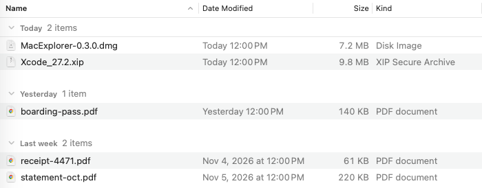
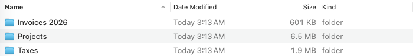
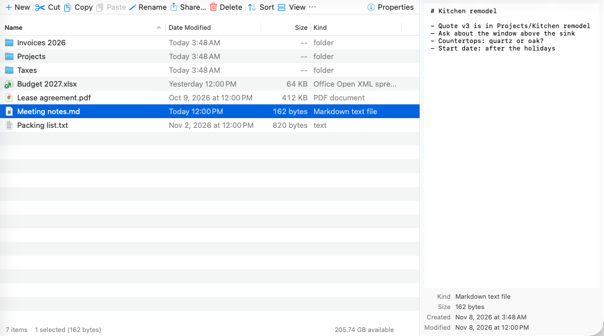
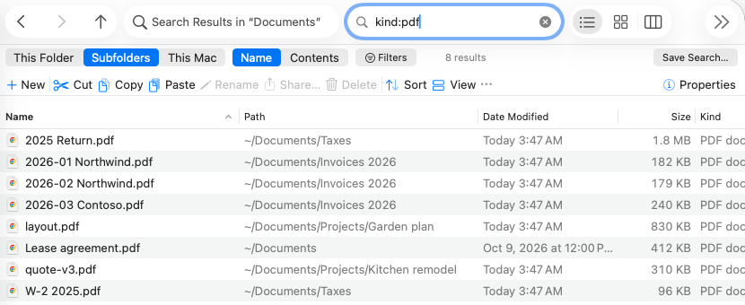
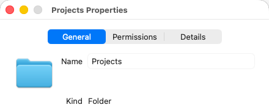
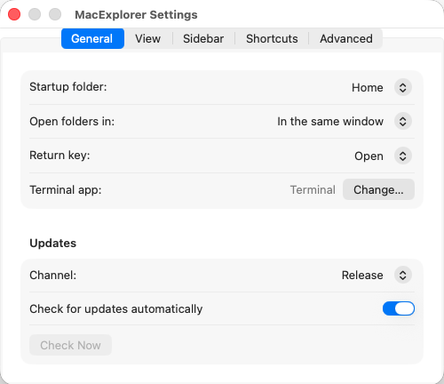

# MacExplorer user guide

How to use every part of MacExplorer.
New here? Start with the [README](README.md).

**Contents**

1. [Tabs](#tabs)
2. [Views](#views)
3. [Folder sizes](#folder-sizes)
4. [Copy a path](#copy-a-path)
5. [Quick Look and the preview pane](#quick-look-and-the-preview-pane)
6. [Search](#search)
7. [Command palette](#command-palette)
8. [Rename many items](#rename-many-items)
9. [Compress and extract](#compress-and-extract)
10. [Properties](#properties)
11. [Settings](#settings)
12. [Updates](#updates)
13. [Feedback and crashes](#feedback-and-crashes)
14. [What MacExplorer can't do](#what-macexplorer-cant-do)

---

## Tabs

Every window can hold several tabs, like Safari.

| To | Do this |
|---|---|
| Open a new tab | ⌘T |
| Open a folder in a new tab | Middle-click it, or right-click › **Open in New Tab** |
| Go to the next / previous tab | ⌃Tab / ⌃⇧Tab |
| Close a tab | ⌘W |
| See all tabs | ⇧⌘\ |
| Open a dragged folder as a tab | Drop it on the **＋** button in the toolbar |

In the sidebar and the folder tree, ⌘-click also opens a new tab.
In the file list, ⌘-click selects more than one item, as usual.

If a copy or move needs your answer, the question appears on the tab that started it.

---

## Views

There are three views.

| View | Shortcut | Good for |
|---|---|---|
| Details | ⌘1 | Sorting by name, date, size or kind |
| Icons | ⌘2 | Photos and images (shows thumbnails) |
| Columns | ⌘3 | Moving through deep folders |

In Columns view:

- → opens the selected folder in the next column.
- ← goes back one column.
- Drag a column's edge to resize it. Double-click the edge to fit the names.

### Each folder remembers its view

Change the view of a folder, and it stays that way the next time you open it.
This covers the view, columns, sort order, icon size, density, grouping and folder sizes.

| Menu command | What it does |
|---|---|
| View › **Use as Default for All Folders** | Makes this view the default for folders you haven't changed |
| View › **Apply to All Folders…** | Makes this view the default and forgets every folder's own view |
| View › **Reset View for This Folder** | Forgets this folder's view |

Folders you never changed follow their Finder view.
The Applications folder opens with large icons.

### Group by

View › **Group By** sorts items into groups you can collapse.

| Group by | Groups |
|---|---|
| Kind | Folders, Documents, Images… |
| Date Modified | Today, Yesterday, Earlier this Week… |
| Size | Tiny, Small, Medium, Large… |
| Name | First letter |

### More columns

Right-click a column header in Details view to add a column.

| Column | Shows |
|---|---|
| Tags | Finder tags |
| Date Last Opened | When you last opened the item |
| Permissions | `rwxr-xr-x` style |
| Owner | The user who owns the item |
| Comments | Finder comments |
| Path | Where a search result lives (search results only) |

Click any column header to sort by it.

### Thumbnails

Icons view shows a picture of each image, PDF or movie instead of a generic icon.
Thumbnails are never made for iCloud files that aren't downloaded.
Turn them off in Settings › View › **Show thumbnails**.

---

## Folder sizes

Finder shows `--` for folder sizes.
MacExplorer can show real sizes.

Choose View › **Calculate Folder Sizes**.

- Sizes are worked out in the background. You can keep working.
- Sorting by Size uses them.
- They update when files change.

A size like **≥ 1.2 MB** means some files couldn't be counted.
Usually they are unreadable, or in iCloud and not downloaded.

MacExplorer never downloads iCloud files to measure them.
It doesn't follow aliases or enter other disks.

---

## Copy a path

Choose Edit › **Copy Path As**, or right-click an item.

| Option | Example |
|---|---|
| POSIX Path (⇧⌘C) | `/Users/alex/Documents/Budget 2027.xlsx` |
| ~ Path | `~/Documents/Budget 2027.xlsx` |
| File URL | `file:///Users/alex/Documents/Budget%202027.xlsx` |
| Name | `Budget 2027.xlsx` |
| Quoted for Shell | `'/Users/alex/Documents/Budget 2027.xlsx'` |

---

## Quick Look and the preview pane

**Quick Look:** press Space to open a big preview of the selection.
Press Space again to close it.
The arrow keys move to the next item while it's open.

If you are typing a name to jump to it, Space counts as part of the name.
So typing `my f` selects `my file.txt` instead of opening Quick Look.

**Preview pane:** press ⌥P, or choose View › **Show Preview Pane**.
It stays open beside the files, like in Windows Explorer.

| You select | The pane shows |
|---|---|
| A text or code file | The text (the first 256 KB) |
| An image, PDF, movie… | A Quick Look preview |
| A folder or several items | A summary |
| An iCloud file that isn't downloaded | A **Download** button. Nothing downloads until you click it. |

Under the preview there are details such as size, dates and dimensions.

---

## Search

Press ⌘F and type.
Press Esc to clear the search and go back to the folder.

The bar under the toolbar sets **where** and **what** to search.

| Where | Searches |
|---|---|
| **This Folder** | Only the folder you are in |
| **Subfolders** | The folder and every folder inside it |
| **This Mac** | Everything Spotlight knows about |

| What | Matches |
|---|---|
| **Name** | File and folder names |
| **Contents** | Text inside files (uses Spotlight) |

- Results show in Details view with a **Path** column.
- **Stop** ends a running search.
- A search shows at most 100,000 results.

### Search words

Type plain words to match names.
Add a key such as `kind:` or `size:` to narrow it down.
All the words must match.

| Type | Finds |
|---|---|
| `invoice` | Names containing "invoice" |
| `"tax return"` | Names containing that exact phrase |
| `*.pdf` | Names ending in `.pdf` |
| `IMG_*` | Names starting with `IMG_` |
| `report?.doc` | `report1.doc`, `reportB.doc`… |
| `kind:image` | Images |
| `ext:jpg,png` | JPG or PNG files |
| `size:>10MB` | Files over 10 MB |
| `modified:today` | Files changed today |
| `created:lastweek` | Files created last week |
| `invoice kind:pdf modified:thisyear` | PDFs with "invoice" in the name, changed this year |

Upper and lower case don't matter.
Neither do accents.

<b>All search keys</b>

| Key | Values |
|---|---|
| `name:` | A word that must be in the name, even in Contents mode |
| `kind:` or `type:` | `folder` `document` `text` `pdf` `image` `movie` `audio` `archive` `app` `code` |
| `ext:` or `extension:` | `pdf`, `.pdf`, `*.pdf`, or a list: `jpg,png` |
| `size:` | `>10MB` `>=1.5GB` `<1KB` `=0` `1MB..10MB` |
| `size:` (words) | `empty` `tiny` `small` `medium` `large` `huge` `gigantic` |
| `modified:` or `date:` | `today` `yesterday` `thisweek` `lastweek` `thismonth` `lastmonth` `thisyear` `lastyear` `last7days` `last30days` |
| `modified:` (dates) | `2026-01-31` `>2026-01-31` `<=2026-01-31` `2026-01-01..2026-01-31` |
| `created:` | The same values as `modified:` |

Size words:

| Word | Size |
|---|---|
| empty | 0 bytes |
| tiny | under 16 KB |
| small | under 1 MB |
| medium | under 128 MB |
| large | under 1 GB |
| huge | under 4 GB |
| gigantic | 4 GB or more |

Rules:

- `KB`, `MB` and `GB` count in thousands, like the sizes in the app. `KiB`, `MiB` and `GiB` count in 1,024s.
- A list of values means "any of them": `kind:pdf,image`.
- If a value isn't understood, the search ignores it and says so under the field.
- A key MacExplorer doesn't know, like `foo:bar`, is searched as plain text.

### Filters

The **Filters** button does the same as the keys, without typing.
You can pick a kind, a date range, a size range and an extension.

### Saved searches

Choose File › **Save Search…**, or click **Save** in the search bar.
The search appears in the sidebar under **SEARCHES**.

- Click it to run it again.
- Drag to reorder.
- Right-click to rename or remove it.

Deleting a saved search never deletes any files.

### Working with results

| To | Do this |
|---|---|
| Open a folder from the results | Double-click it |
| Go back to the results | ⌘[ |
| Open the folder that holds an item | Go › **Open Containing Folder** (⌥⌘R) |

Results stay up to date.
Items you trash or move disappear, and renamed items show their new names.

### When Spotlight is needed

Contents searches and This Mac use Spotlight.
If a disk isn't indexed, MacExplorer searches names instead and tells you.

Subfolders search skips protected folders (Desktop, Documents, Downloads, iCloud Drive) unless you've already given access.
It tells you how many it skipped.
It never pops up a privacy prompt.

---

## Command palette

Press ⇧⌘P and type a few letters of any command or folder.
Press Return to run the highlighted row, or Esc to close the palette.

- It lists every command that works right now, with its shortcut.
- It also lists your favorites and recent folders as "Go to …" rows.
- What you used last comes first.

---

## Rename many items

Select two or more items and press F2.
You can also right-click and choose **Rename N Items…**, or use File › **Rename Items…**.

| Field | What it does |
|---|---|
| Find / Replace with | Replaces every match. Turn on **Regular expression** to use `$1`… for groups and `$$` for a `$`. |
| Prefix / Suffix | Adds text before or after the name |
| Case | lowercase, UPPERCASE, Title Case or Sentence case |
| Apply to | The name only, the name and extension, or only the extension |
| Add numbers | Before or after the name, or **Replace name** for "Trip (1)", "Trip (2)"… |

The list below shows each new name as you type.
**Rename** stays off while a new name is invalid, used twice, or taken by another item in the folder.

- Names can trade places: `a.txt` ↔ `b.txt` works, and so do chains like `1 → 2 → 3`.
- One ⌘Z puts every name back.
- If the Mac crashes in the middle, MacExplorer puts every item back at its old name the next time it opens.

---

## Compress and extract

| To | Do this |
|---|---|
| Make a zip | Right-click › **Compress ▸** › **.zip**, or File › Compress |
| Make an Apple Archive (.aar) | Right-click › **Compress ▸** › **.aar** |
| Unpack an archive | Right-click it › **Extract Here** |

The archive appears next to the first item and is selected.
Extract Here opens .zip, .tar, .tar.gz, .tgz, .tar.bz2, .tar.xz, .gz and .aar files.
An archive with one top-level folder is unpacked as that folder.
Anything else goes into a new folder named after the archive.

- A name that is taken gets a number: `photos.zip` becomes `photos 2.zip`.
- Cancel leaves nothing behind.
- Archives with entries that would land outside the folder (`../`, absolute paths, tricks with links) are refused before anything is written.
- ⌘Z removes what was made.

---

## Properties

Select an item and press ⌘I.

Properties works like Windows Explorer's.
It shows a live folder size and has a **Permissions** tab.

**Custom icons:** drop an image on the icon at the top of Properties, or click it and paste (⌘V).
**Remove Custom Icon** goes back to the normal one.
⌘Z undoes either.

**Access Control:** the Permissions tab lists the item's access control entries (who may read, write or delete it).
Use **Add Entry**, **Edit Entry** and **Remove Entry** to change them.
Entries inherited from a parent folder are shown but can't be edited.
If you aren't the item's owner, the list is read-only.
MacExplorer won't save a Deny entry that would stop you from seeing or changing the list itself (one that applies to you and denies Read permissions or Change permissions).

---

## Settings

Open Settings with ⌘,.

| Tab | What you can change |
|---|---|
| General | Startup folder, where folders open, what Return does, the Terminal app, updates |
| View | Hidden files, file extensions, thumbnails, row density, date format, the command bar |
| Sidebar | Which sections and locations show |
| Shortcuts | Any keyboard shortcut |
| Advanced | Delete confirmations, the full path in the window title, crash reports |

**Return key:** choose whether Return opens the item (like Windows) or renames it (like Finder).
F2 renames, unless you pick the Finder preset.

**Shortcuts:** change any shortcut, or start from a **Preset**.
**Explorer** (the default) uses Windows-style keys plus the Mac ones.
**Finder** uses Finder's keys only: ⌘O opens, ⇧⌘G goes to a folder, and Return renames.
A shortcut's **Reset** button gives it back the keys of the preset you started from.
**Restore All Defaults** goes back to the Explorer keys.
**Export…** saves your shortcuts to a file, and **Import…** loads one.
An imported file with two commands on one key, or with a key macOS keeps for itself, is refused and the clashes are listed.
Commands from a newer MacExplorer are skipped.

**Icon pack:** Settings › General › **Icon pack** shows your own icons for file types inside MacExplorer.
A pack is a folder of images named after the extension, for example `pdf.png` or `swift.icns`, plus `folder.png` for folders.
Apps, custom icons and disks keep their own icons.

**Function keys:** F2 (rename) and F5 (refresh) need the fn key, unless your Mac is set to use F1, F2… as standard keys.
That setting is in System Settings › Keyboard.

---

## Updates

MacExplorer checks for updates once a day and downloads them in the background.
When one is ready, a **Restart to Update** button appears in the toolbar.

| To | Go to |
|---|---|
| Choose Release or Beta versions | Settings › General › Updates › **Channel** |
| Check right now | Settings › General › **Check Now** |
| Go back to an earlier version | MacExplorer › **Install Previous Version…** |

Switching from Beta to Release never downgrades you.
You stay on your beta until a newer release comes out.

---

## Feedback and crashes

| To | Do this |
|---|---|
| Report a bug | Help › **Report a Bug…** |
| Ask for a feature | Help › **Request a Feature…** |

Both open a pre-filled GitHub issue.
You need a GitHub account.
You see everything before it's sent.

If MacExplorer crashes, it offers to send a report the next time it opens.
Turn this off in Settings › Advanced.

---

## What MacExplorer can't do

| Limit | Why | What to do |
|---|---|---|
| It can't replace Finder everywhere | macOS has no way to change the system file browser | "Show in Finder", the Dock icon and Open/Save panels still use Finder |
| Cut in MacExplorer, paste in Finder makes a copy | Finder doesn't understand MacExplorer's cut | Drag the files instead, or use ⌥⌘V in Finder |
| No "Put Back" from the Trash | — | Use Undo (⌘Z) to restore trashed items |
| Very big copies paste slowly in other apps | Above 5,000 items, the paths are handed over one by one | Pasting inside MacExplorer is still fast |
| No Libraries, drive letters or NTFS permissions | These are Windows features | — |
| Needs macOS 26 or later | It uses the newest macOS design | — |

The other way round works: copy in Finder with ⌘C, then press ⌥⌘V in MacExplorer to move.
